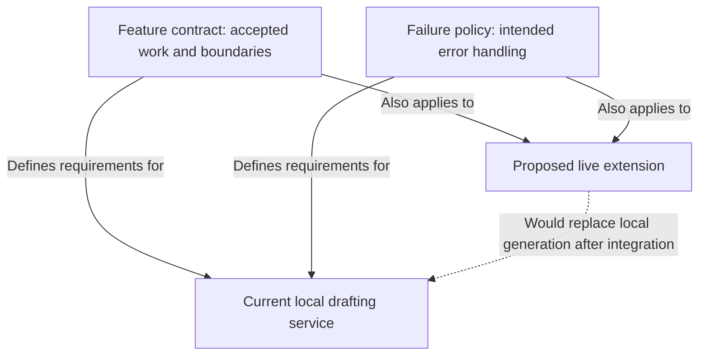
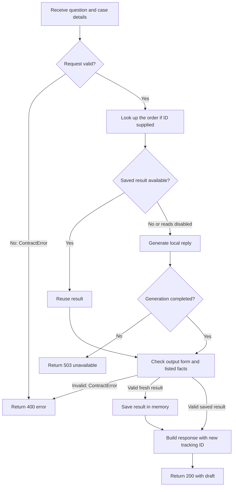
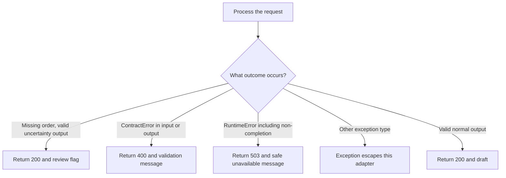
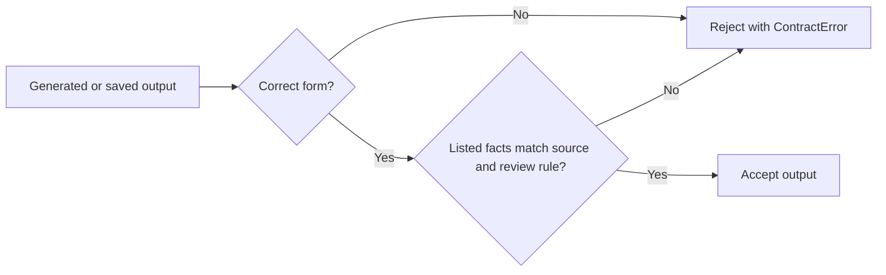
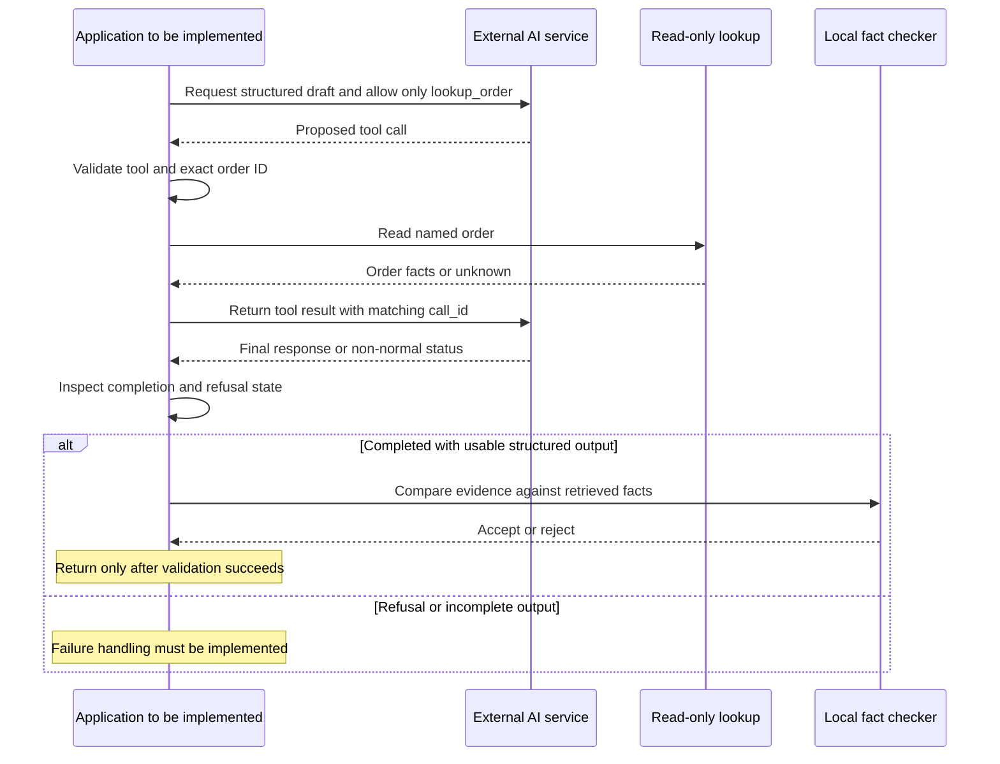

# Understand the contract: general and business-specific perspectives

This guide uses two perspectives together. The **general perspective** explains the software mechanisms in language that applies to many systems. The **business-specific perspective** explains their meaning in this customer-support lab. General analogies are teaching aids; business rules are tied to this repository's evidence. A missing business decision is identified as unresolved rather than filled in with an assumption.

## 1. The system in everyday language

**This is a writing assistant for a customer-support agent. It looks up one order, prepares a suggested reply, checks the attached facts, and returns the draft. It does not send the reply or issue a refund.** That purpose is a **documented requirement** in the [feature contract:3–4,25–30](feature_contract.md#L25-L30); the read-only lookup and returned response are **confirmed implementation** in [lookup:7–14](../src/source_tool.py#L7-L14) and [service:9–23](../src/service.py#L9-L23).

Think of three instructions on a support desk:

- **The feature contract** says what information to accept, what to return, and which boundaries to respect ([contract:6–33](feature_contract.md#L6-L33), documented requirement).
- **The failure policy** says what should happen when information is missing or something goes wrong ([policy:3–15](failure_policy.md#L3-L15), documented requirement).
- **The live API extension** describes a teaching exercise that would use an external AI service in place of the current local reply writer ([extension:3–15,45](live_api_extension.md#L3-L15), proposed behavior).

Today, the reply writer is a **simulator**: code that chooses fixed sentences from the order's status. It does not ask an external AI service. A question and optional order ID go in; a draft, supporting facts, review flag, usage estimates, and tracking ID come out ([model:12–44](../src/model.py#L12-L44), [response construction:23](../src/service.py#L23-L23), confirmed implementation).

### The two perspectives at a glance

| Aspect | General perspective: how to understand the software | Business-specific perspective: what it means here | Evidence and status |
|---|---|---|---|
| Purpose | Software accepts information and produces a controlled result | Help a support agent draft an empathetic reply about an order | [Contract:3–4](feature_contract.md#L3-L4), documented requirement |
| Source of truth | A response should rely on an authoritative input | Only the named order's local record supplies order status, delivery estimate, and refund eligibility | [Contract:26–28](feature_contract.md#L26-L28), [lookup:11–14](../src/source_tool.py#L11-L14), documented requirement / confirmed implementation |
| Contract | An agreement about inputs, outputs, and boundaries | A case and customer message go in; draft, evidence, review signal, usage, and tracking ID come out | [Contract:6–23](feature_contract.md#L6-L23), documented requirement |
| Failure | An operation cannot meet its rules or complete | Missing order facts require uncertainty; incorrect order evidence must not reach the customer as accepted evidence | [Policy:6,11](failure_policy.md#L6-L11), documented requirement; [facts:3–15](../src/semantic_validation.py#L3-L15), confirmed implementation |
| Authority | A component may have permission to do some things but not others | Read an order and draft text; never send messages, issue refunds, or update orders | [AGENTS:7–8](../AGENTS.md#L7-L8), repository requirement; [service:9–23](../src/service.py#L9-L23), confirmed implementation |
| Live integration | Replace a local component with an external service | A real model could write support drafts, but the same source and action boundaries still apply | [Extension:11–15,45](live_api_extension.md#L11-L15), proposed behavior; [contract:25–33](feature_contract.md#L25-L33), documented requirement |

Business scope is **support reply drafting**, not a complete case-management, delivery-tracking, or refund-processing system. That distinction follows from the narrow contract and read/return execution path; no broader workflow is supplied ([contract:3–4,29](feature_contract.md#L25-L29), [service:9–23](../src/service.py#L9-L23), confirmed scope; broader-system absence limited to the inspected repository).

### Sources and analysis baseline

All three primary documents were read in full. The requested filename `docs/live_api_extenstion.md` was **not found**. Searching `learner_day5/docs/` located the spelling variant **[`docs/live_api_extension.md`](live_api_extension.md)**, which was used. Neither filename was renamed; this explanation preserves the requested output spelling, `EXPLAIN_CONTRAC.md`.

Analysis date: **2026-10-30**, Asia/Calcutta. Branch: `subodh/training/baseline_repo`. Commit: `fa73052a328525b67815d5654eb40819e245dbc5`. These were confirmed using `git branch --show-current` and `git rev-parse HEAD`. Paths below are relative to this document in `learner_day5/docs/`. Only this explanation was added during this task; the seven guides from the earlier task already existed.

**Evidence labels:** “documented requirement” means a written rule; “confirmed implementation” means inspected code; “test-backed” means a relevant existing test passed during this analysis; “proposed behavior” means an extension instruction rather than a connected implementation; “inference” means a reasoned conclusion; “unresolved” means the available evidence does not settle it.

## 2. How the three documents fit together

| Document | Main question it answers | Rules or behavior it describes | Connection to the other documents | Evidence |
|---|---|---|---|---|
| `feature_contract.md` | What must this feature accept, return, and protect? | Field rules, evidence, human review, read-only order access, user-scoped caching | Defines the boundaries for both local and possible live generation | [Contract:6–42](feature_contract.md#L6-L42), documented requirement |
| `failure_policy.md` | What should happen when a step cannot be trusted or completed? | Input rejection, missing-data replies, retries, refusal handling, source checks, cache fallback | Applies to errors around the contract; includes provider errors that the local simulator does not actually produce | [Policy:5–15](failure_policy.md#L5-L15), documented requirement; [local generation:16–44](../src/model.py#L16-L44), confirmed implementation |
| Requested `live_api_extenstion.md`; actual `live_api_extension.md` | How could the teaching exercise use a real external model? | SDK setup, structured responses, proposed tool loop, status checks, final evidence checking | Keeps the core safety boundaries; would introduce provider calls and failures covered by the policy | [Extension:3–15,45](live_api_extension.md#L3-L15), proposed behavior and explicit limitations |

These are **not three steps executed one after another**. The contract and failure policy are rulebooks. The extension is an optional approach to generation. The present adapter explicitly constructs the local simulator ([api:2–7](../src/api.py#L2-L7), confirmed implementation).

**General perspective:** requirements describe the expected behavior; implementation is the mechanism that tries to meet it. **Business-specific perspective:** the contract describes a safe support draft, the failure policy describes what to do when that draft cannot be trusted, and the live extension changes the writer rather than granting extra authority over orders ([contract:25–33](feature_contract.md#L25-L33), [policy:5–15](failure_policy.md#L5-L15), [extension:11–15](live_api_extension.md#L11-L15), documented/proposed requirements).



This is a **relationship diagram**, not execution order. The dashed arrow is proposed, not an existing call.

| Stage | Evidence and status |
|---|---|
| Contract | [Business constraints:25–33](feature_contract.md#L25-L33), documented requirement |
| Failure policy | [Policy table:3–15](failure_policy.md#L3-L15), documented requirement |
| Current service | [Adapter construction:7](../src/api.py#L7-L7), [service:9–23](../src/service.py#L9-L23), confirmed implementation |
| Optional replacement | [Simulator description:12–13](../src/model.py#L12-L13), [extension limitation:45](live_api_extension.md#L45-L45), proposed behavior |

## 3. The normal process, step by step

The documented entry point is `POST /v1/reply-drafts`. “POST” means submitting information to an API, a software interface. In this checkout, the entry point is actually the Python function `post_reply_draft(payload, user_id="demo-user")`. It returns a number and dictionary; it does not start a web server or authenticate a user ([contract:6–14](feature_contract.md#L6-L14), documented requirement; [api:1–14](../src/api.py#L1-L14), confirmed implementation).

**Diagram scope:** the implemented adapter path for one request. A **cache** is temporary memory of previous work. The order lookup happens before checking that memory.



| Stage | Plain-language explanation and why it matters | Inputs, outputs, or settings | Evidence and status |
|---|---|---|---|
| A–B | Check that the request has permitted fields and sensible sizes before spending generation work | Required case and message; details in section 5 | [validation:3–18](../src/validation.py#L3-L18), confirmed implementation; [policy:5](failure_policy.md#L5-L5), documented rationale |
| C | Read only the requested order, so another order is not substituted | Truthy `order_id`; local JSON loaded when lookup object is constructed | [service:11](../src/service.py#L11-L11), [lookup:7–14](../src/source_tool.py#L7-L14), confirmed implementation; [contract:26](feature_contract.md#L26-L26), documented requirement |
| D–E | Avoid repeating generation for matching work | Key includes user, request fields, source version, prompt version, model class | [cache:6–12](../src/cache.py#L6-L12), [service:12–13](../src/service.py#L12-L13), confirmed implementation; [repeat test:9–10](../tests/test_service_cache.py#L9-L10), test-backed |
| F–G | Pick a fixed reply and require completed generation | Missing, shipped, delivered, or other order status | [model:19–38](../src/model.py#L19-L38), [service:15–16](../src/service.py#L15-L16), confirmed implementation |
| H | Check both the output's form and the facts it lists | Four generation fields; evidence checked against retrieved record | [shape:20–29](../src/validation.py#L20-L29), [facts:3–15](../src/semantic_validation.py#L3-L15), confirmed implementation |
| I | Keep accepted fresh work in this process's memory | Stores model result, not a database record | [service:19](../src/service.py#L19-L19), [cache:5,12](../src/cache.py#L12-L12), confirmed implementation |
| J–K | Return draft and a new tracking ID | `DraftResponse`; status `200` | [service:23](../src/service.py#L23-L23), [api:12](../src/api.py#L12-L12), confirmed implementation |
| X, U | Give a mapped error rather than a successful draft | `400` for `ContractError`; `503` for `RuntimeError` | [api:13–14](../src/api.py#L13-L14), confirmed implementation |

An order that cannot be found still produces a valid uncertainty draft and `needs_human_review=true`. A `200` means drafting succeeded; it does not mean the customer's problem was solved or that a review task was created ([model:21–23](../src/model.py#L21-L23), [service:23](../src/service.py#L23-L23), confirmed implementation).

**General perspective:** the software successfully returning a result is different from the result resolving the original problem. **Business-specific perspective:** support staff must read the draft and review signal; this service cannot confirm a missing order or complete a refund. A review flag is information for the caller, not evidence that anyone has been assigned the case ([model:21–23](../src/model.py#L21-L23), [service:23](../src/service.py#L23-L23), [contract:29](feature_contract.md#L29-L29), confirmed implementation / documented boundary).

## 4. Failure policy explained

The policy distinguishes **bad input**, **unavailable information**, **generation problems**, **untrustworthy output**, and **cache problems**. A **retry** means trying the operation again. A **fallback** means taking an alternative path, such as continuing without cache. The policy names these options, but the current service does not implement all of them ([policy:5–15](failure_policy.md#L5-L15), documented requirement; [service:9–23](../src/service.py#L9-L23), confirmed implementation).

### Policy versus actual handling

| Failure or trigger | What the system does | What the user/caller sees | Practical consequence | Evidence |
|---|---|---|---|---|
| Invalid request shape or size | Policy: 400 without generation. Code: raises `ContractError` before model call | `400`, error `invalid_request_or_output`, validation message | Caller must correct request | [Policy:5](failure_policy.md#L5-L5); [validation:3–18](../src/validation.py#L3-L18), [service:10–15](../src/service.py#L10-L15), [api:13](../src/api.py#L13-L13), confirmed implementation; [tests:7–10](../tests/test_contract.py#L7-L10), test-backed |
| Missing order | Policy and code: acknowledge missing facts, request review | `200`, uncertainty draft, `needs_human_review=true`, `order_record_missing` | No fabricated status/date; review is a flag, not an automatic handoff | [Policy:6](failure_policy.md#L6-L6), [model:21–23](../src/model.py#L21-L23), [service:23](../src/service.py#L23-L23), confirmed implementation |
| Model timeout/transient error | Policy: one bounded retry for retryable errors, then safe unavailable response. Code: no timeout/retry control in the inspected service | If a `RuntimeError` reaches adapter: `503`; other exception types can escape | Intended retry behavior is unresolved for an actual provider | [Policy:7](failure_policy.md#L7-L7), [service:13–22](../src/service.py#L13-L22), [api:13–14](../src/api.py#L13-L14), documented requirement versus confirmed implementation |
| Provider refusal | Policy: preserve refusal state, request review. Simulator: any status other than `completed` becomes `RuntimeError` | Adapter returns generic `503`; no separate refusal field | Current generic status handling is not the documented refusal workflow | [Policy:8](failure_policy.md#L8-L8), [model:14–19](../src/model.py#L14-L19), [service:16](../src/service.py#L16-L16), [api:14](../src/api.py#L14-L14), confirmed implementation; provider behavior unresolved |
| Incomplete/truncated output | Policy: reject, one bounded retry only if safe, then fail safely. Code: reject immediately | Service raises; adapter maps `RuntimeError` to `503` | Partial output is not returned as a normal draft; no second attempt | [Policy:9](failure_policy.md#L9-L9), [service:16](../src/service.py#L16-L16), [api:14](../src/api.py#L14-L14), [test:11–14](../tests/test_failures.py#L11-L14), test-backed service rejection |
| Invalid JSON/schema | Policy: bounded repair/retry then failure. Core receives a Python dictionary, checks its structure, and does no repair/retry | Shape errors become `400`, `invalid_request_or_output` | The same code covers caller-input and generator-output mistakes | [Policy:10](failure_policy.md#L10-L10), [shape:20–29](../src/validation.py#L20-L29), [model result:44](../src/model.py#L44-L44), [api:13](../src/api.py#L13-L13), confirmed implementation; live JSON parsing unresolved |
| Wrong but well-formed evidence | Policy: reject claim and substitute uncertainty or review. Code: raises `ContractError`; no substitute draft | Adapter `400`; service alone raises `ContractError`, a `ValueError` subtype | Factual rejection exists; uncertainty replacement does not | [Policy:11](failure_policy.md#L11-L11), [facts:7–12](../src/semantic_validation.py#L7-L12), [error type:21–22](../src/models.py#L21-L22), [api:13](../src/api.py#L13-L13), [test:7–10](../tests/test_failures.py#L7-L10), test-backed |
| Tool timeout/not found | Policy: return unknown. Current local lookup returns `None` for unknown ID; no timeout control | Unknown ID becomes uncertainty draft; timeout behavior not implemented | Missing record is handled; external failure handling remains separate | [Policy:12](failure_policy.md#L12-L12), [lookup:11–14](../src/source_tool.py#L11-L14), [model:21–23](../src/model.py#L21-L23), confirmed implementation |
| Unknown tool / invalid arguments | Policy: stop and safe error. Core has a single directly injected lookup; direct invalid lookup arguments raise `ValueError` | Normal request checks usually reject bad IDs first; bare lookup errors are not automatically `ContractError` | A live tool dispatcher still needs to enforce the proposed restrictions | [Policy:13](failure_policy.md#L13-L13), [lookup:6,11–14](../src/source_tool.py#L11-L14), [validation:12–13](../src/validation.py#L12-L13), [extension:11](live_api_extension.md#L11-L11), confirmed core / proposed live handling |
| Cache unavailable | Policy: continue uncached. Service has no cache-error fallback | Depends on raised exception: `RuntimeError` maps to 503; others may escape | Cache is intended as optional but failure tolerance is not implemented | [Policy:14](failure_policy.md#L14-L14), [service:12–22](../src/service.py#L12-L22), [api:13–14](../src/api.py#L13-L14), confirmed implementation |
| Stale cache/version mismatch | Policy: ignore and retrieve/generate anew. Code includes version in key, but source is loaded once | Changed in-memory version selects another key; a disk edit alone does not refresh existing lookup | Versioned keys help only when updated source/version reaches the object | [Policy:15](failure_policy.md#L15-L15), [key:6–8](../src/cache.py#L6-L8), [lookup:7–10](../src/source_tool.py#L7-L10), [service:11–12](../src/service.py#L11-L12), confirmed implementation |

### Actual failure decisions

**General perspective:** failure handling should distinguish invalid input, unavailable dependencies, and unusable output. **Business-specific perspective:** this lab also distinguishes “we cannot verify the order” from “we cannot generate a draft.” The first can return a cautious draft with review required; the second maps to an unavailable response when it is a `RuntimeError`. The code does not define a review queue, staff owner, or response-time commitment for either situation ([model:21–23](../src/model.py#L21-L23), [api:12–14](../src/api.py#L12-L14), [service:9–23](../src/service.py#L9-L23), confirmed implementation within this path; operational decisions unresolved).

**Scope:** implemented adapter and its immediate call path. This diagram intentionally does not add the policy's unimplemented retries or fallbacks.



| Stage | Evidence and status |
|---|---|
| A–B | [Adapter try block:9–14](../src/api.py#L9-L14), confirmed implementation |
| C | [Missing-source output:21–23](../src/model.py#L21-L23), [response:23](../src/service.py#L23-L23), confirmed implementation |
| D | [ContractError handler:13](../src/api.py#L13-L13), confirmed implementation |
| E | [Non-completion rejection:16](../src/service.py#L16-L16), [RuntimeError handler:14](../src/api.py#L14-L14), confirmed implementation |
| F | Only those two exception handlers exist [api:13–14](../src/api.py#L13-L14), confirmed implementation within this adapter |
| G | [Success return:12](../src/api.py#L12-L12), confirmed implementation |

**What is recorded?** The core stores accepted model results in memory and tracks cache hits/misses and model calls. Responses include estimated usage and a request ID. The inspected adapter/service/model/cache contain no logging calls or persistent audit writer; the benchmark prints metrics. This is a limited source-inspection finding, not proof about an unprovided host ([cache:5–12](../src/cache.py#L5-L12), [model:18](../src/model.py#L18-L18), [service:19–23](../src/service.py#L19-L23), [api:1–14](../src/api.py#L1-L14), [benchmark:22–23](../src/benchmark.py#L22-L23), confirmed implementation).

**Partial results and exhausted retries:** current code rejects non-completed generation before accepting output; it has no retry attempt to exhaust. The policy gives a maximum of one retry for specified situations, but no durations, backoff schedule, or complete retryable-error list. The extension says not to publish partial claims before final fact checking. Those details must not be invented ([service:15–18](../src/service.py#L15-L18), confirmed implementation; [policy:7–10](failure_policy.md#L7-L10), documented requirement; [extension:15](live_api_extension.md#L15-L15), proposed behavior).

## 5. Feature contract explained

A **feature** here is the specific capability “draft a support reply.” Its **contract** is the agreement between its caller and its components: accepted inputs, promised output fields, and safety boundaries. The contract's wording is an intended interface; validation code reveals what is actually enforced ([contract:3–33](feature_contract.md#L3-L33), documented requirement; [validators:3–29](../src/validation.py#L3-L29), confirmed implementation).

### Business rules versus technical rules

| Kind of rule | General meaning | Business-specific meaning in this repository | Evidence and status |
|---|---|---|---|
| Technical input rule | Reject fields or sizes the component cannot accept | Reject an extra `send_now` field or a customer message over 2,000 characters | [Validation:6–11](../src/validation.py#L6-L11), [test:7–10](../tests/test_contract.py#L7-L10), confirmed implementation / test-backed |
| Business factual rule | Claims must use the correct source | Do not transfer facts from another order; do not invent delivery dates or refund eligibility | [Contract:26–28](feature_contract.md#L26-L28), documented requirement; [service:11](../src/service.py#L11-L11), [facts:7–12](../src/semantic_validation.py#L7-L12), confirmed evidence-level implementation |
| Business authority rule | Returned recommendations do not authorize actions | A draft may suggest escalation; it cannot issue a refund or send the message | [Contract:29](feature_contract.md#L29-L29), documented requirement; [service:23](../src/service.py#L23-L23), confirmed output behavior |
| Business uncertainty rule | Missing facts should be acknowledged | Missing order record returns uncertainty and review required | [Policy:6](failure_policy.md#L6-L6), [model:21–23](../src/model.py#L21-L23), documented requirement / confirmed implementation |
| Existing business fact, not calculated policy | A value may be supplied rather than decided by this component | `refund_eligible` is read from fixture data; the code does not calculate return windows or decide exceptions | [Records:4–7](../data/source_records.json#L4-L7), [model:28–30](../src/model.py#L28-L30), confirmed configuration / implementation |

For example, `ORD-1043` has `refund_eligible=true` and `refund_reason=delivered_within_return_window` in the fixture. This does **not** establish how long the return window is, which countries it applies to, or whether a refund has been approved or paid. Those rules are not calculated by the inspected generator; `refund_reason` is not among its allowed evidence fields ([record:5](../data/source_records.json#L5-L5), [model:25–35](../src/model.py#L25-L35), [allowed fields:7](../src/semantic_validation.py#L7-L7), confirmed implementation/configuration; broader business policy unresolved).

### Request fields and boundary rules

| Field or rule | Plain-language meaning | Requirement/default | What happens if violated | Evidence |
|---|---|---|---|---|
| Request body | The submitted form | Core accepts a Python `dict`; only five named fields | `ContractError`, adapter 400 | [validation:3–8](../src/validation.py#L3-L8), confirmed implementation |
| `case_id` | Which support case this belongs to | Required string, 1–40 characters; no format pattern checked | Wrong type/length: 400; whitespace-only passes code | [contract:10](feature_contract.md#L10-L10), documented requirement; [validation:9–10](../src/validation.py#L9-L10), confirmed implementation |
| `customer_message` | Customer's question | Required string, nonblank, max 2,000 characters | Blank/too long/wrong type: 400 | [contract:11](feature_contract.md#L11-L11), [validation:11](../src/validation.py#L11-L11), confirmed implementation; [oversize test:7–8](../tests/test_contract.py#L7-L8), test-backed |
| `order_id` | The only order allowed for this request | Optional string or `None`, max 40; empty string accepted | Bad type/length: 400; empty/absent skips lookup | [contract:12,26](feature_contract.md#L12-L12), [validation:12–13](../src/validation.py#L12-L13), [service:11](../src/service.py#L11-L11), confirmed implementation |
| `locale` | Requested language identifier | `en` or `fr`; absent defaults to `en` | Unsupported hashable value: 400; list/dict can cause unhandled `TypeError`; both accepted languages currently use English wording | [contract:13](feature_contract.md#L13-L13), [validation:14–15](../src/validation.py#L14-L15), [model:20–38](../src/model.py#L20-L38), confirmed implementation; [default test:6](../tests/test_contract.py#L6-L6), test-backed default only |
| `conversation_id` | Label connecting related requests | Optional opaque string; code adds max 80 characters; no history is loaded | Bad type/length: 400 | [contract:14,31](feature_contract.md#L14-L14), [validation:16–18](../src/validation.py#L16-L18), [service:9–23](../src/service.py#L9-L23), confirmed implementation |
| `user_id` | Caller-supplied identity for cache separation | Separate function argument; defaults to `demo-user`; not an allowed payload field | No authentication check in adapter; extra payload field rejected | [api:9](../src/api.py#L9-L9), [allowed keys:6–8](../src/validation.py#L6-L8), [cache key:7](../src/cache.py#L7-L7), confirmed implementation |

“Opaque” means callers should treat the identifier as a label, without interpreting its internal characters. The only documented state/history promise is no persisted conversation history in this core lab ([contract:14,31](feature_contract.md#L31-L31), documented requirement).

### Output fields and boundaries

| Field or rule | Plain-language meaning | Requirement/default | What happens if violated | Evidence |
|---|---|---|---|---|
| `case_id` | Echo of the accepted case | Copied from request | No separate output check needed for this copy | [contract:17](feature_contract.md#L17-L17), [service:23](../src/service.py#L23-L23), confirmed implementation |
| `draft` | Suggested reply text | String up to 600 characters; empty string is allowed by current check | Output violation maps to 400 | [contract:18](feature_contract.md#L18-L18), [shape:23](../src/validation.py#L23-L23), [api:13](../src/api.py#L13-L13), confirmed implementation |
| `evidence` | Attached facts, each with `field` and `value` | List; allowed fields `status`, `estimated_delivery`, `refund_eligible`; submitted values must equal source | Unknown/mismatching facts rejected; existing source requires some evidence | [contract:19,30](feature_contract.md#L19-L19), [shape:24–26](../src/validation.py#L24-L26), [facts:5–12](../src/semantic_validation.py#L5-L12), confirmed implementation; [semantic tests:7–13](../tests/test_semantic_validation.py#L7-L13), test-backed |
| `needs_human_review` | Whether a person should review uncertainty | Boolean; missing source must set true | Wrong type or missing-source false is rejected | [contract:20,28](feature_contract.md#L20-L20), [shape:27](../src/validation.py#L27-L27), [facts:13–14](../src/semantic_validation.py#L13-L14), confirmed implementation |
| `review_reasons` | Labels explaining review | List of strings; no enforced list of allowed labels or rule requiring nonempty reasons | Wrong collection/item type rejected | [contract:21](feature_contract.md#L21-L21), [shape:28](../src/validation.py#L28-L28), confirmed implementation |
| `usage` | Estimated generation work and price | `input_tokens`, `output_tokens`, `estimated_cost_usd`; USD cost rounded to eight decimals | No independent usage validator; cache hits repeat original usage | [contract:22](feature_contract.md#L22-L22), [service:23](../src/service.py#L23-L23), [model:40–43](../src/model.py#L40-L43), confirmed implementation |
| `request_id` | Tracking label for this response | New UUID-derived 12-character hexadecimal string per successful response | No persistence/search service implemented here | [contract:23](feature_contract.md#L23-L23), [service:23](../src/service.py#L23-L23), confirmed implementation |
| Stable public contract | Callers should not face unexpected field/interface changes | Repository instruction requires human approval for changing public request/response contract | This task changes no interface | [AGENTS:5](../AGENTS.md#L5-L5), repository requirement |

The simulator's “tokens” are rough text-size estimates, not actual provider counts: character counts divided by four. Its price is explicitly a teaching rate, $1 per million input tokens and $4 per million output tokens. Dates are copied from fixture strings; the code does not validate calendar formats or recalculate delivery/refund eligibility ([model:25–43](../src/model.py#L25-L43), [fixtures:4–7](../data/source_records.json#L4-L7), confirmed implementation/configuration).

### What is normalized and versioned?

The cache key strips whitespace at the edges of `customer_message`; the request itself retains the original message. It includes user ID, case ID, message, order ID, locale, conversation ID, source version, `prompt-v1`, and model class name. JSON keys are sorted before hashing; clients need not submit request keys in a particular order. It does not include every configurable model option. Different supplied users are separated, but identity must still be trusted by the caller ([validation:18](../src/validation.py#L18-L18), [cache:6–8](../src/cache.py#L6-L8), [service:12](../src/service.py#L12-L12), confirmed implementation; [isolation test:11–12](../tests/test_service_cache.py#L11-L12), test-backed).

### The two checks



| Stage | Evidence and status |
|---|---|
| A | Both fresh/cached branches validate [service:17–22](../src/service.py#L17-L22), confirmed implementation |
| B | Exact four generation fields and types [validation:20–29](../src/validation.py#L20-L29), confirmed implementation |
| C | Evidence equality and missing-source review check [semantic:3–15](../src/semantic_validation.py#L3-L15), confirmed implementation |
| X | Shape can pass while facts fail [test:7–10](../tests/test_semantic_validation.py#L7-L10), test-backed |
| D | Validator returns accepted dictionary [semantic:15](../src/semantic_validation.py#L15-L15), confirmed implementation |

**Important limit:** this checks attached facts, not the sentences in `draft`. It also does not reject duplicate evidence, require all relevant fields, or strictly type each evidence value before equality comparison. Accepted output is therefore not a guarantee that every sentence is true ([shape:20–29](../src/validation.py#L20-L29), [facts:3–15](../src/semantic_validation.py#L3-L15), confirmed implementation; wider consequence is inference).

### Valid and invalid examples

**Illustrative example—not executed:** a request using the actual `ORD-1042` fixture:

```json
{"case_id":"CASE-1","customer_message":"Where is my package?","order_id":"ORD-1042"}
```

This exact payload is declared in [benchmark:8](../src/benchmark.py#L8-L8). Validation defaults locale to `en`. The fixture says shipped, estimated delivery `2026-11-02`, refund eligibility false; the generator would return the shipped template and matching evidence, review false, plus usage and a new ID ([validation:14–18](../src/validation.py#L14-L18), [record:4](../data/source_records.json#L4-L4), [model:25–35](../src/model.py#L25-L35), [service:23](../src/service.py#L23-L23), confirmed implementation; example not run during this task).

**Test-backed invalid example:** `{"case_id":"C1","customer_message":"Help","send_now":true}`. `send_now` is not allowed; the existing test confirms validation raises `ContractError`. At the adapter, that error maps to 400. This test was rerun and passed; it tests the validator, not the adapter's status code ([test:9–10](../tests/test_contract.py#L9-L10), [validation:6–8](../src/validation.py#L6-L8), [api:13](../src/api.py#L13-L13)).

## 6. Live API extension explained

“Live” means contacting an external AI service using an account, an enabled model, and its software development kit (**SDK**, the client library). The extension is an instructor-led exercise and a Markdown skeleton. The actual adapter still uses `DeterministicModel`; no live provider implementation is connected ([extension:3–6,45](live_api_extension.md#L3-L6), documented/proposed behavior; [api:2–7](../src/api.py#L2-L7), confirmed implementation).

| Area | Current local behavior | Documented optional extension | Evidence / status |
|---|---|---|---|
| Reply writer | Fixed local templates | `client.responses.parse(...)` requesting a structured response | [model:16–44](../src/model.py#L16-L44), confirmed implementation; [extension:9,32–40](live_api_extension.md#L32-L40), proposed behavior |
| Account/dependencies | Core path imports local modules and standard library | API account, enabled model, `openai` SDK; skeleton imports `pydantic` | [api:2–7](../src/api.py#L2-L7), [model:1,17](../src/model.py#L17-L17), confirmed implementation; [extension:3–6,18–20](live_api_extension.md#L18-L20), documented setup |
| Configuration | Adapter constructs local simulator | Secret in `OPENAI_API_KEY`; choose `OPENAI_MODEL`; skeleton uses placeholder `MODEL_FROM_ENV` | [api:7](../src/api.py#L7-L7), confirmed implementation; [extension:3–6,33–34](live_api_extension.md#L33-L34), documented setup; loading placeholder unresolved |
| Order access | Service directly calls read-only lookup before generation | Model proposes only `lookup_order`; application validates ID, performs lookup, returns result with matching `call_id` | [service:11](../src/service.py#L11-L11), confirmed implementation; [extension:11–12](live_api_extension.md#L11-L12), proposed tool loop |
| Fact checking | Separate local validator | Still perform local fact checking before returning draft | [service:17–22](../src/service.py#L17-L22), confirmed implementation; [extension:13](live_api_extension.md#L13-L13), proposed requirement |
| Usage/cost | Character-based teaching estimates | Observe provider usage and calculate with current rate card outside prompt | [model:40–43](../src/model.py#L40-L43), confirmed implementation; [extension:14](live_api_extension.md#L14-L14), proposed behavior |
| Failure/streaming | Generic non-completion rejection; no streaming path in service | Inspect status/refusal/incomplete state; do not publish partial claims before final validation | [service:15–23](../src/service.py#L15-L23), confirmed implementation; [extension:10,15,45](live_api_extension.md#L15-L15), proposed behavior and limitations |

The extension does **not** specify a new public route or a new request/response contract. It describes different generation mechanics, while the contract still limits facts, actions, and user/conversation scope. The skeleton sends fixed example text including fixture facts, rather than wiring an incoming payload and complete tool loop ([extension:33–40,45](live_api_extension.md#L33-L40), [contract:25–33](feature_contract.md#L25-L33), documentation; lack of complete wiring explicitly acknowledged).

**General perspective:** replacing a local component introduces a network dependency, credentials, provider statuses, and compatibility work. **Business-specific perspective:** a more flexible writer still must not invent order facts or promise unauthorized outcomes. The extension's example instruction says “Never promise a refund,” and its teaching sequence keeps local evidence checking. Better wording is not proof of eligibility or permission to perform a transaction ([extension:3–15,36](live_api_extension.md#L36-L36), documented/proposed requirements; [contract:26–30](feature_contract.md#L26-L30), documented business boundary).

### Proposed live interaction, not executable wiring

The sequence below depicts the **teaching sequence**, not what the Markdown skeleton fully implements. “Application” means integration code that still needs to be written. No retry arrow is drawn: exact provider-error integration remains unresolved.



| Stage | Evidence and status |
|---|---|
| Structured request | [Extension teaching steps 1–2:9–10](live_api_extension.md#L9-L10), proposed behavior |
| Tool proposal and validation | [Step 3:11](live_api_extension.md#L11-L11), proposed behavior |
| Lookup and matching result | [Steps 3–4:11–12](live_api_extension.md#L11-L12), proposed behavior; available local [lookup:11–14](../src/source_tool.py#L11-L14), confirmed implementation |
| Inspect status/refusal | [Step 2:10](live_api_extension.md#L10-L10), proposed behavior; exact implementation unresolved |
| Fact check before return | [Steps 5 and 7:13–15](live_api_extension.md#L13-L15), proposed behavior |
| Failure branch | [Failure policy:7–11](failure_policy.md#L7-L11), documented requirement; [extension:45](live_api_extension.md#L45-L45), explicit incomplete implementation |

The skeleton does not include authentication, retries, observability (operational recording), or production error handling. The text does not define numerical timeout settings or a detailed retry classification. The extension warns that SDK syntax and model access can change; this analysis explains the repository text and does not verify its compatibility with a currently released SDK. No dependency was installed and no external API called ([extension:3–6,41–45](live_api_extension.md#L41-L45), documented limitations; analysis scope).

## 7. One end-to-end example

The contract and failure policy connect to an implemented local workflow. The live extension is a separate proposal, so combining it into today's call path would invent functionality. The following pair uses an existing test fixture and a deliberate simulator failure, then explains where live generation would differ ([api:7](../src/api.py#L7-L7), [failure tests:7–14](../tests/test_failures.py#L7-L14), [extension:45](live_api_extension.md#L45-L45)).

### Successful case — illustrative example, not executed

1. A caller submits `{"case_id":"C1","customer_message":"Can I get refund?","order_id":"ORD-1042"}`. This is the payload used by the wrong-evidence test, but here imagine the ordinary model with `wrong_claim=False` ([test:8–10](../tests/test_failures.py#L8-L10), [model default:14](../src/model.py#L14-L14)).
2. The form passes its field/size checks; omitted locale becomes `en` ([validation:6–18](../src/validation.py#L6-L18), confirmed implementation).
3. The lookup returns the fixture: shipped, estimated delivery `2026-11-02`, refund false ([record:4](../data/source_records.json#L4-L4), configuration).
4. Assuming no saved result, the simulator attaches those facts and chooses the shipped reply. It does not interpret the refund question to choose another template ([service:13–15](../src/service.py#L13-L15), [model:25–35](../src/model.py#L25-L35), confirmed implementation).
5. Both checks pass; the accepted result is saved and the adapter would return 200, draft, review false, evidence, usage, and a new ID ([service:17–23](../src/service.py#L17-L23), [api:12](../src/api.py#L12-L12), confirmed implementation).

### Failure case — service rejection is test-backed

1. The existing test makes a **fresh service** with `DeterministicModel(wrong_claim=True)` and the same lookup/payload. This is deliberate failure injection, not a customer action ([test:7–10](../tests/test_failures.py#L7-L10)).
2. Request validation and lookup still pass. The model flips the last evidence value; with `ORD-1042`, refund false becomes true ([model:25–32](../src/model.py#L25-L32), [record:4](../data/source_records.json#L4-L4), confirmed implementation).
3. The evidence has the right shape, but the fact checker rejects the mismatch. The test asserting an `Evidence mismatch` error passed during this analysis ([test:9–10](../tests/test_failures.py#L9-L10), [semantic:11–12](../src/semantic_validation.py#L11-L12), test-backed).
4. The policy says never present the unsupported value and describes uncertainty/review as the replacement. The service implements rejection, but not replacement. If this service is used through the adapter, `ContractError` maps to `400` with `invalid_request_or_output` and the mismatch message. That adapter result is code-confirmed, not asserted by this service-level test ([policy:11](failure_policy.md#L11-L11), [service:17–19](../src/service.py#L17-L19), [api:13](../src/api.py#L13-L13)).
5. No refund, message, or order write occurs in this path. The failed result is not saved because the exception occurs before `cache.set` ([service:17–19](../src/service.py#L17-L19), [lookup:11–14](../src/source_tool.py#L11-L14), confirmed implementation).

For a future live version, provider generation and a validated tool interaction would replace the local template step; returned evidence would still need to match the retrieved record. The extension is not an exemption from the contract or failure policy ([extension:11–15](live_api_extension.md#L11-L15), proposed behavior; [contract:26–30](feature_contract.md#L26-L30), documented requirement).

### Read the same example through both perspectives

| Moment | General perspective | Business-specific perspective | Evidence and status |
|---|---|---|---|
| Request accepted | Data passes type and size rules | There is a case/message to draft for; this does not establish a real customer's entitlement | [Validation:3–18](../src/validation.py#L3-L18), confirmed implementation |
| Record found | The requested key resolves to data | The exercise's `ORD-1042` facts say shipped and refund false | [Lookup:14](../src/source_tool.py#L14-L14), [record:4](../data/source_records.json#L4-L4), confirmed implementation/configuration |
| Ordinary output | Output checks pass | A draft can report those fixture facts, but the fixed shipped template does not actually answer the refund question | [Model:25–35](../src/model.py#L25-L35), confirmed implementation; answer-relevance limitation is inference |
| Injected wrong evidence | Structure passes; source comparison fails | A refund-eligibility claim contradicts the order record and is rejected | [Failure test:7–10](../tests/test_failures.py#L7-L10), test-backed |
| Error returned | Adapter maps validation error to 400 | Caller receives no replacement support draft, despite policy describing uncertainty/review | [Api:13](../src/api.py#L13-L13), confirmed implementation; [policy:11](failure_policy.md#L11-L11), documented requirement |

This exposes a business question beyond technical correctness: must a draft directly answer the customer's question, or is a correct order-status template sufficient for the exercise? The simulator's selection uses order status, not message meaning; the contract asks for a concise empathetic support reply but gives no answer-relevance test ([model:16–44](../src/model.py#L16-L44), confirmed implementation; [contract:3–4,35–42](feature_contract.md#L35-L42), documented requirement; acceptance criterion unresolved).

## 8. Important exceptions, limitations, and unanswered questions

| Item | What is known | What remains uncertain | Practical impact | Evidence or next check |
|---|---|---|---|---|
| Misspelled requested source | `live_api_extenstion.md` absent; `live_api_extension.md` present and used | Whether source references should later be corrected | Readers must use actual path; no rename made | `rg --files learner_day5/docs` and [actual extension](live_api_extension.md), command-output evidence |
| Authentication | Contract says authenticated case/user scope; adapter trusts supplied/default identity | Intended hosting and authentication middleware | Cache separation alone does not authorize access | [Contract:4,31](feature_contract.md#L31-L31), [api:9–11](../src/api.py#L9-L11); inspect host before exposing endpoint |
| Retry/fallback differences | Policy prescribes bounded handling; core has one generation attempt and no cache-error fallback | Which policy items are intended for simulator versus live implementation | Do not promise automatic recovery | [Policy:7–15](failure_policy.md#L7-L15), [service:13–22](../src/service.py#L13-L22) |
| Accepted locale | `en`/`fr` accepted; simulator templates are English | Whether locale means required translation or reserved metadata | French caller can receive English | [Validation:14–15](../src/validation.py#L14-L15), [model:20–38](../src/model.py#L20-L38); obtain expected French responses |
| Malformed locale | List/dict cannot be tested for membership in this set without `TypeError`; adapter only catches two other exception classes | Full invalid-type matrix not executed during this task | Intended useful 4xx response is not guaranteed for every malformed input | [Validation:15](../src/validation.py#L15-L15), [api:13–14](../src/api.py#L13-L14), confirmed static implementation |
| Missing/empty order | Optional absent/null/empty ID skips lookup; unknown record becomes uncertainty | Whether empty ID should be prohibited | A successful response may ask for human review | [Validation:12–13](../src/validation.py#L12-L13), [service:11](../src/service.py#L11-L11), [model:21–23](../src/model.py#L21-L23) |
| Delivered review wording | Delivered template mentions agent review of returns, but flag stays false | Whether that wording should require `needs_human_review=true` | Text and machine-readable review signal may convey different expectations | [Model:20,35–38](../src/model.py#L35-L38); clarify review semantics |
| Other order status | Any non-shipped/non-delivered record gets preparation reply and unavailable-estimate reason | Which additional statuses are valid | Unexpected status could get misleading wording | [Model:33–38](../src/model.py#L33-L38); define supported source schema |
| Evidence versus prose | Only submitted evidence is compared; duplicate facts and empty draft can pass | Required guarantee for all sentences | A live model would need stronger claim controls if this is a product requirement | [Shape:20–29](../src/validation.py#L20-L29), [facts:3–15](../src/semantic_validation.py#L3-L15) |
| Source freshness | JSON is loaded once at lookup construction; source version enters key | Reload lifecycle and live update mechanism | Editing source file alone does not update current service | [Lookup:7–10](../src/source_tool.py#L7-L10), [service:12](../src/service.py#L12-L12) |
| Cache bypass | `use_cache=False` skips reads but still writes accepted result | Whether flag should disable all cache activity | Benchmark “uncached” means every call generates, not that storage is untouched | [Service:13–19](../src/service.py#L13-L19), [test:13–14](../tests/test_service_cache.py#L13-L14), test-backed generation count |
| Cache lifetime/configuration | In-memory dictionary has no expiry; key uses model class name and fixed `prompt-v1` | Service lifetime, model-option changes, retention needs | Unbounded unique requests or changing options need lifecycle decisions | [Cache:3–12](../src/cache.py#L3-L12), [service:12](../src/service.py#L12-L12), [model options:14–15](../src/model.py#L14-L15); capacity consequences inferred, not profiled |
| Cached usage | Saved result's usage is returned again | Original-generation versus incremental-request accounting | Summing response costs can overcount repeat work | [Service:13–23](../src/service.py#L13-L23), [same-user cache test:9–10](../tests/test_service_cache.py#L9-L10) |
| Import-time errors | Importing adapter constructs lookup and reads JSON outside request handler | Intended initialization error reporting | Missing/bad fixture can prevent adapter import | [Api:7–10](../src/api.py#L7-L10), [lookup:7–10](../src/source_tool.py#L7-L10) |
| Live integration and compatibility | Markdown skeleton is incomplete and warns about changing SDK/model access | Current SDK compatibility, complete tool loop, timeout values, retry classes | Treat as teaching material, not ready-to-run production integration | [Extension:3–6,41–45](live_api_extension.md#L41-L45); review official SDK docs when implementing |

### Business decisions that cannot be inferred from the code

| Decision | What the evidence establishes | What a business owner would need to decide |
|---|---|---|
| Refund eligibility policy | Fixtures contain booleans/null and reason labels; generator copies available eligibility | Actual return-window length, geographic/product exceptions, approval authority; none should be invented from fixture labels ([records:4–7](../data/source_records.json#L4-L7), [model:28–30](../src/model.py#L28-L30)) |
| Human review operations | Missing/processing cases can set a review flag | Who reviews, how work is assigned, and how soon; no such operational process is executed by `create` ([model:21–23,36–38](../src/model.py#L36-L38), [service:23](../src/service.py#L23-L23)) |
| Language commitment | `fr` is accepted; English text is generated | Whether French support is required before release or locale is only metadata ([validation:14–15](../src/validation.py#L14-L15), [model:20–38](../src/model.py#L20-L38)) |
| Communication approval | Contract defines a human-facing draft and excludes sending | Which external process approves and sends the final message; no sending integration is provided ([contract:4,29](feature_contract.md#L29-L29), [service:23](../src/service.py#L23-L23)) |
| Success measurement | Core returns status, draft, evidence, review signal, and usage estimates | Required answer relevance, handling time, customer outcome, or review-quality measures; these are not defined by the returned fields ([models:12–19](../src/models.py#L12-L19), [contract:35–42](feature_contract.md#L35-L42)) |

These are **unresolved decisions**, not proposed new rules. The general engineering question is whether the mechanism works as specified; the business question is whether the specified result is useful and authorized for the support process.

### Checks performed in this analysis

Read all primary documents, `AGENTS.md`, every `src/*.py` and `tests/*.py` file, and `data/source_records.json`. Ran `python -B -m unittest discover -s tests -v` from `learner_day5/`: **12 tests passed**, captured runtime 0.007 seconds. Relevant assertions are in [contract tests:5–13](../tests/test_contract.py#L5-L13), [failure tests:6–14](../tests/test_failures.py#L6-L14), [semantic tests:6–16](../tests/test_semantic_validation.py#L6-L16), and [cache tests:6–14](../tests/test_service_cache.py#L6-L14). “Test-backed” in this explanation refers only to assertions in those executed tests.

No external provider call, dependency installation, source change, fixture mutation, or benchmark rerun was performed during this task. Examples explicitly labeled illustrative were not executed. New diagrams were reviewed against code/teaching steps; relative paths, heading anchors, line ranges, and code fences were mechanically checked. No Mermaid rendering engine was run, so visual rendering remains unverified. Earlier analysis remains available in [process flow](process_flow.md), [current behavior](current_behavior.md), and [verification record](verification_and_open_questions.md); it is supporting context, not a substitute for the source evidence above.

## 9. Quick reference

### Seven takeaways

1. **The output is a draft for a person.** Sending messages and issuing refunds are outside the feature ([contract:4,29](feature_contract.md#L25-L29)).
2. **The contract is the agreement about accepted work and returned fields.** The code adds specific checks and exposes some gaps ([contract:6–23](feature_contract.md#L6-L23), [validation:3–29](../src/validation.py#L3-L29)).
3. **Today’s writer uses fixed local rules.** It is not a connected live AI model ([api:7](../src/api.py#L7-L7), [model:16–44](../src/model.py#L16-L44)).
4. **Missing facts can produce a successful uncertainty reply.** Review is a returned flag, not an executed handoff ([model:21–23](../src/model.py#L21-L23), [service:23](../src/service.py#L23-L23)).
5. **Correct shape does not prove truth.** Evidence is checked separately; prose is not checked by that validator ([shape:20–29](../src/validation.py#L20-L29), [semantic:3–15](../src/semantic_validation.py#L3-L15)).
6. **The policy describes more recovery than the core implements.** Do not assume retries, repair, or cache fallback already work ([policy:7–15](failure_policy.md#L7-L15), [service:13–22](../src/service.py#L13-L22)).
7. **The live extension needs integration work.** It keeps final local fact checks and explicitly omits a complete production implementation ([extension:11–15,45](live_api_extension.md#L11-L15)).

### Short glossary

| Term | Plain-language meaning |
|---|---|
| API | An agreed interface through which software asks other software to do work |
| Contract | The rules both caller and component are expected to follow |
| Payload / JSON | The submitted data / a common text format for named fields and values |
| Schema / shape | Rules about which fields exist and their types |
| Evidence / semantic validation | Attached facts / checking their meaning against the source |
| Cache | Temporary saved work that can avoid doing the same operation again |
| Retry / fallback | Try again / use a different route when the preferred route fails |
| SDK | A library used to call another service |
| Token | A model's unit of text processing; this simulator uses a rough character-based estimate |
| `200` / `400` / `503` | Here: successful draft / mapped request-or-output validation error / generation unavailable |
| Tool / `call_id` | A permitted operation the model can propose / the label linking a result to its proposed call |

The repository-specific token, status, and tool meanings above are supported by [model:40–43](../src/model.py#L40-L43), [api:12–14](../src/api.py#L12-L14), and [extension:11–12](live_api_extension.md#L11-L12).

### Inspected documents and key files

- Primary sources: [failure policy](failure_policy.md), [feature contract](feature_contract.md), [actual live extension spelling](live_api_extension.md).
- Repository rules: [AGENTS.md](../AGENTS.md).
- Entry/coordinator: [api.py](../src/api.py), [service.py](../src/service.py).
- Checks and data containers: [validation.py](../src/validation.py), [semantic_validation.py](../src/semantic_validation.py), [models.py](../src/models.py).
- Generation/data/cache: [model.py](../src/model.py), [source_tool.py](../src/source_tool.py), [cache.py](../src/cache.py), [source_records.json](../data/source_records.json).
- Measurement and package entry: [benchmark.py](../src/benchmark.py), [empty package initializer](../src/__init__.py).
- Tests: [test_contract.py](../tests/test_contract.py), [test_failures.py](../tests/test_failures.py), [test_semantic_validation.py](../tests/test_semantic_validation.py), [test_service_cache.py](../tests/test_service_cache.py).
