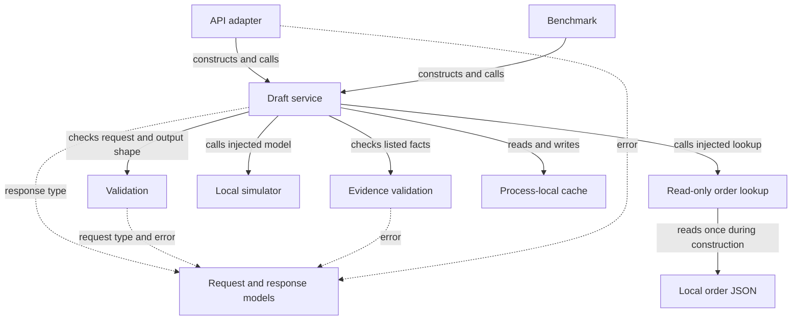

# Which parts depend on which others

The **service** is the coordinator. The **adapter** constructs it with a simulator and a read-only lookup. The service receives those objects rather than constructing them itself; this is simple dependency injection. A default cache is constructed if none, or another falsey value, is passed. **Implementation; confirmed** — [adapter wiring:2–7](../src/api.py#L2-L7), [service constructor:8](../src/service.py#L8-L8), [benchmark wiring:10](../src/benchmark.py#L10-L10).

## Component map

**Scope:** core executable wiring and imports, not the optional extension. Solid arrows represent construction, calls, or data reads as labeled; dashed arrows represent types/imports. All edges are implementation-confirmed by the table below.

| Component / diagram node | Depends on | Purpose | Wiring/call evidence | External requirements | Uncertainty |
|---|---|---|---|---|---|
| Adapter A | Service, simulator, lookup, `ContractError` | Construct shared objects; return status and dictionary | [`api`:2–14](../src/api.py#L2-L14) | Readable fixture at import | Hosting/authentication absent from inspected adapter; caller ownership unknown |
| Service S | Cache, validators, response model; injected model/tool | Orchestrate request | [`DraftService`:1–23](../src/service.py#L1-L23) | Tool must expose `version` and be callable; model must expose `generate` | Interface is implicit; no Protocol enforced here |
| Request/shape validation V | `DraftRequest`, `ContractError` | Enforce fields and sizes | [`validation`:1–29](../src/validation.py#L1-L29) | None beyond local code | Type edge cases not exhaustively tested |
| Evidence validation E | `ContractError`; supplied record | Compare submitted evidence | [`semantic_validation`:1–15](../src/semantic_validation.py#L1-L15) | Correct source record from caller | Does not validate prose |
| Simulator M | `dataclasses`, `time`; request/record attributes | Select fixed response and estimate usage | [`model`:1–44](../src/model.py#L1-L44), [service call:15](../src/service.py#L15-L15) | Record must have fields used by branch | Arbitrary replacement model behavior unknown |
| Lookup L | `json`, `pathlib`; order JSON J | Load version and records; retrieve exact key | [`source_tool`:1–14](../src/source_tool.py#L1-L14), [records:1–9](../data/source_records.json#L1-L9) | Readable, valid JSON with expected keys | No refresh protocol in this class |
| Cache C | `hashlib`, `json`; request attributes | Key and save model results in memory | [`cache`:1–12](../src/cache.py#L1-L12), [service:12–22](../src/service.py#L12-L22) | Process memory | Multi-process synchronization and expiry not supplied |
| Models T | `dataclasses` | Request/response containers and custom error | [`models`:1–22](../src/models.py#L1-L22) | Python union annotation support | Dataclass annotations do not validate runtime values |
| Benchmark B | `statistics`, `time`; core objects | Repeat request and report metrics | [`benchmark`:1–23](../src/benchmark.py#L1-L23) | Local source JSON | Prices and output-token assumption are illustrative |

Every table row above is **implementation evidence; confirmed** for inspected wiring. Uncertainty describes the limits of that evidence, not a claimed integration.

## External dependencies

No dependency manifest or lockfile was found by `rg --files --hidden` over this checkout excluding `.git` and metadata; the inspected inventory contains source, tests, data, and docs. Thus there are **no discovered declared package versions**, rather than proof of an unspecified external environment. Standard-library imports observed in `src/*.py` are `dataclasses`, `time`, `statistics`, `hashlib`, `json`, `pathlib`, and `uuid`. Tests use `unittest`. **Inventory/import-search evidence; confirmed within checkout** — [verification scope](verification_and_open_questions.md#commands-and-outcomes), [model:1,17](../src/model.py#L17-L17), [benchmark:1](../src/benchmark.py#L1-L1), [cache:1](../src/cache.py#L1-L1), [source:1–2](../src/source_tool.py#L1-L2), [service:1](../src/service.py#L1-L1), [models:1](../src/models.py#L1-L1), [tests:1–3](../tests/test_contract.py#L1-L3).

The pre-existing README declares Python 3.10+ ([README:5–8](../README.md#L5-L8), documentation). The optional extension mentions `openai` and imports `pydantic` in a Markdown skeleton, with no pinned version and no executable import from the core. `MODEL_FROM_ENV` is illustrative, not implemented configuration loading. **Documentation versus import evidence; confirmed** — [extension:3–6,18–40](live_api_extension.md#L18-L40), [adapter model selection:2–7](../src/api.py#L2-L7).

No external database, queue, provider, or storage SDK is called along the traced core path. This conclusion is limited to all inspected `src/*.py` imports and call bodies, not any unprovided deployment. The actual persistence boundary is a local JSON read; saved generations are process memory. **Implementation; confirmed within scope** — [lookup:7–14](../src/source_tool.py#L7-L14), [cache:3–12](../src/cache.py#L3-L12), [model:16–44](../src/model.py#L16-L44), [service:9–23](../src/service.py#L9-L23).

## Coupling, dynamic wiring, and ownership

| Observation | Evidence and interpretation | Type / confidence |
|---|---|---|
| No internal circular import in inspected 11-file source graph | Imports shown in [api:2–5](../src/api.py#L2-L5), [service:2–5](../src/service.py#L2-L5), [validation:1](../src/validation.py#L1-L1), [semantic:1](../src/semantic_validation.py#L1-L1), [benchmark:2–6](../src/benchmark.py#L2-L6); lower-level modules do not import callers | Implementation / confirmed within graph |
| No registry, plugin loader, or dynamic import wiring found in source | Full source inspection; search `import`; construction is explicit in [api:7](../src/api.py#L7-L7) and [benchmark:10](../src/benchmark.py#L10-L10) | Implementation/search / confirmed within source |
| Service assumes specific collaborator attributes | Uses `tool.version`, callable tool, `model.generate`, and result attributes [service:11–23](../src/service.py#L11-L23) | Implementation / confirmed |
| Source shape tightly affects model | Lookup returns raw dictionaries [source:14](../src/source_tool.py#L14-L14); simulator indexes status and shipped delivery [model:25–34](../src/model.py#L25-L34) | Implementation / confirmed |
| Output checks duplicated on cache hit/miss branches | Same shape/evidence pair [service:17–22](../src/service.py#L17-L22) | Implementation / confirmed; maintainability impact inferred |
| Cost formulas exist in two places with different output assumptions | [model:40–43](../src/model.py#L40-L43), [benchmark:18–20](../src/benchmark.py#L18-L20) | Implementation / confirmed |
| Model configuration identity incomplete in cache key | Class name passed [service:12](../src/service.py#L12-L12); model also has `wrong_claim` and `status` settings [model:14–15](../src/model.py#L14-L15) | Implementation / confirmed; impact depends on collaborator reuse |

Configuration precedence and environment names are listed in [the onboarding guide](README.md#environment-and-configuration). No deployment or team ownership metadata was supplied by the inspected inventory; operational ownership remains unresolved ([verification questions](verification_and_open_questions.md#open-questions)).
