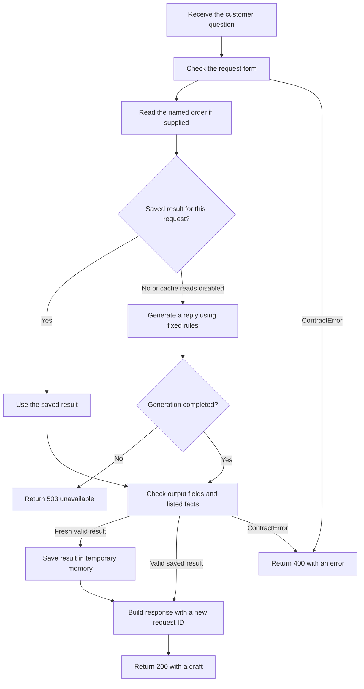
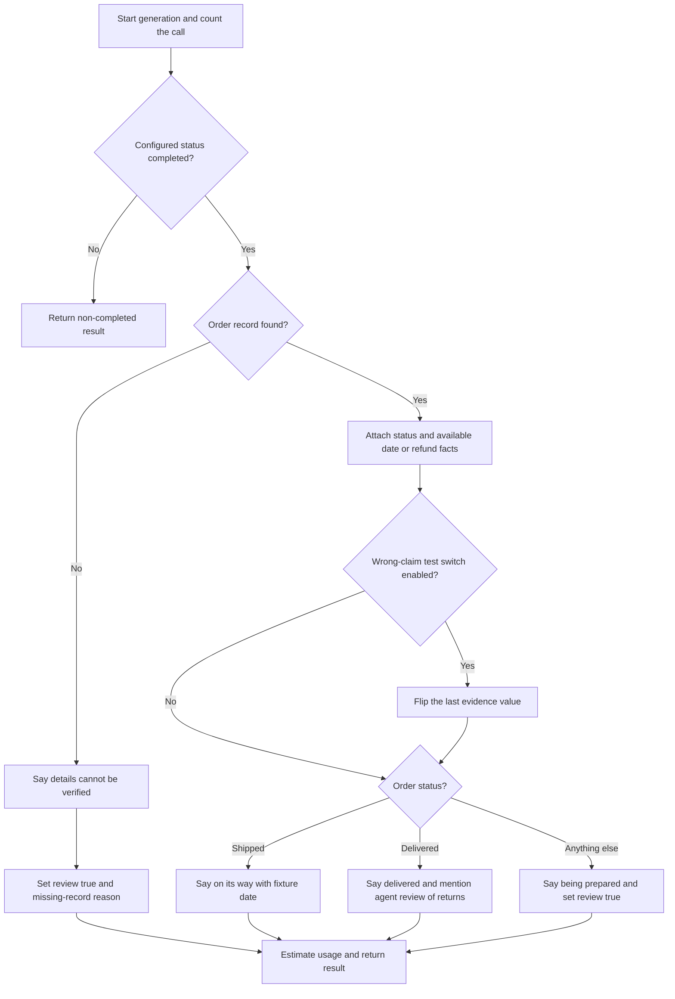
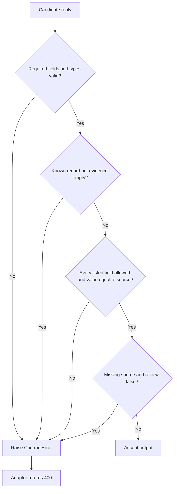
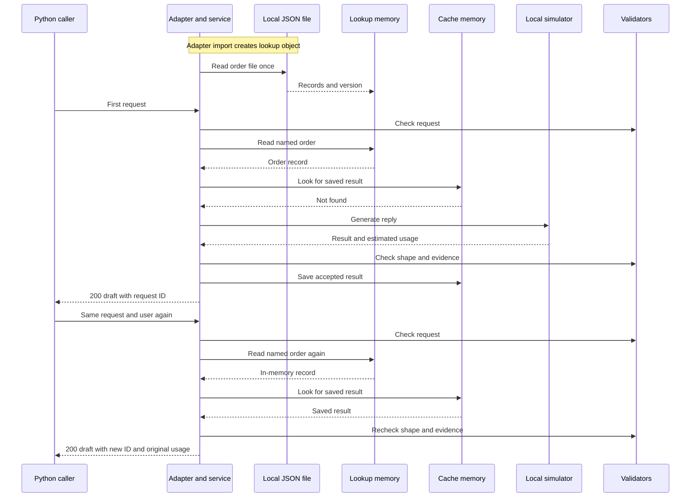
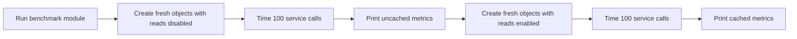

# Follow one customer question through the code

Think of a support desk with a form checker, an order book, a reply writer, and a fact checker. In this exercise, the writer follows fixed templates. A **cache** is temporary memory of earlier work; **evidence** is a list of facts attached to the reply. These roles come from [the service coordinator:9–23](../src/service.py#L9-L23), [writer:16–44](../src/model.py#L16-L44), and [fact checker:3–15](../src/semantic_validation.py#L3-L15) (**implementation; confirmed**).

How to read the diagrams: a box is an action; a diamond is a question; an arrow means the next action or data passed. Dashed links in the dependency guide mean imports or types, not execution. Every diagram below has its own evidence table. No human approval or message-sending step is drawn as executable behavior: the code returns text, while the intended human use is documented in [the contract:3–4,25–29](feature_contract.md#L25-L29).

## 1. The complete journey

**Scope and trigger:** one call to `post_reply_draft(payload, user_id)`, the local adapter. All paths below are confirmed implementation; exception types outside its two handlers escape to the caller. This is a Python call, not a running HTTP route ([api:1–14](../src/api.py#L1-L14)).

In plain language: the service checks the form first, looks up the order, and checks whether it has already done this work. It writes only when needed. Both new and saved replies pass the same checks. Even a reply that says “we cannot verify this order” can be a successful 200 response; its review flag tells the caller it needs attention. The flag does not create a support task ([model:21–23](../src/model.py#L21-L23), [response construction:23](../src/service.py#L23-L23), implementation; confirmed).

| Node/stage | Responsibility | Source symbol | Evidence |
|---|---|---|---|
| A | Enter adapter with default user if omitted | `post_reply_draft` | [api:9–11](../src/api.py#L9-L11), implementation / confirmed |
| B | Validate allowed keys, types, lengths | `validate_request` | [validation:3–18](../src/validation.py#L3-L18), implementation / confirmed |
| C | Skip missing/empty ID or read one record | `create`, `__call__` | [service:11](../src/service.py#L11-L11), [lookup:11–14](../src/source_tool.py#L11-L14), implementation / confirmed |
| D–E | Build identity key and retrieve saved result | `key`, `get`, `create` | [cache:6–11](../src/cache.py#L6-L11), [service:12–14](../src/service.py#L12-L14), implementation / confirmed |
| F–G | Generate once and check completion | `generate`, `create` | [model:16–44](../src/model.py#L16-L44), [service:15–16](../src/service.py#L15-L16), implementation / confirmed |
| H | Check form and evidence on either branch | Validators | [service:17–22](../src/service.py#L17-L22), implementation / confirmed |
| I | Save only fresh results that passed checks | `set` | [service:19](../src/service.py#L19-L19), [cache:12](../src/cache.py#L12-L12), implementation / confirmed |
| J–K | Return draft, original usage, new ID | `DraftResponse`, adapter | [service:23](../src/service.py#L23-L23), [api:12](../src/api.py#L12-L12), implementation / confirmed |
| U, X | Translate RuntimeError / ContractError | `post_reply_draft` | [api:13–14](../src/api.py#L13-L14), implementation / confirmed |

## 2. How the writer picks the words

**Scope and trigger:** simulator generation after a cache miss or disabled cache read. All paths are confirmed implementation. Current fixture branches were exercised; the catch-all branch for an unexpected status is established statically. No AI or external service participates ([model:16–44](../src/model.py#L16-L44)).

Example actually checked: `ORD-1042` produces “on its way” with the fixture's `2026-11-02` estimate; `ORD-1044` produces a preparation reply with review required. These are canned responses selected by order status. The simulator does not interpret what “Help” means or translate for `fr` ([record fixtures:4–6](../data/source_records.json#L4-L6), [generation:20–44](../src/model.py#L20-L44), [probe record](verification_and_open_questions.md#local-probes)).

| Node/stage | Responsibility | Source symbol | Evidence |
|---|---|---|---|
| A–C | Increment call counter; handle simulated non-completion | `DeterministicModel.generate` | [model:18–19](../src/model.py#L18-L19), implementation; [incomplete test:11–14](../tests/test_failures.py#L11-L14), test / confirmed |
| D–F | Missing record becomes uncertainty and review | `generate` | [model:20–23](../src/model.py#L20-L23), implementation / confirmed |
| G | Collect available source evidence | `generate` | [model:25–30](../src/model.py#L25-L30), implementation / confirmed |
| H–I | Deliberately inject wrong evidence for testing | `wrong_claim`, `generate` | [model:14–15,31–32](../src/model.py#L31-L32), [failure test:7–10](../tests/test_failures.py#L7-L10), implementation/test / confirmed |
| J–M | Select wording and review branch | `generate` | [model:33–38](../src/model.py#L33-L38), implementation / confirmed |
| N | Character-based usage and illustrative cost | `generate` | [model:39–44](../src/model.py#L39-L44), implementation / confirmed |

## 3. The two checks and their failure paths

**Scope and trigger:** a fresh or saved output enters validation. All paths below are implementation-confirmed. “Facts match” means the listed evidence matches; checking every sentence is an unresolved product requirement, not an implemented stage ([validators](../src/semantic_validation.py#L3-L15)).

A correctly filled form can still lie. Existing tests prove wrong refund evidence is rejected. A separate probe also showed the limit: “Your refund was issued” passes when its attached evidence only says the order shipped. The checker reads the attached facts, not the prose. This is why “accepted” must not be interpreted as proof every sentence is true ([semantic test:7–10](../tests/test_semantic_validation.py#L7-L10), [probe P3](verification_and_open_questions.md#local-probes)).

| Node/stage | Responsibility | Source symbol | Evidence |
|---|---|---|---|
| A–B | Exact keys, draft length, collection and flag types | `validate_draft_shape` | [validation:20–29](../src/validation.py#L20-L29), implementation / confirmed |
| C | Known source requires some evidence | `validate_evidence` | [semantic:5–6](../src/semantic_validation.py#L5-L6), implementation / confirmed |
| D | Loop through evidence and compare with source | `validate_evidence` | [semantic:7–12](../src/semantic_validation.py#L7-L12), implementation/test / confirmed |
| E–F | Require review when source is missing, then accept | `validate_evidence` | [semantic:13–15](../src/semantic_validation.py#L13-L15), implementation / confirmed |
| X–G | Reject instead of repairing or substituting text | Validators, adapter | [validation:22–28](../src/validation.py#L22-L28), [semantic:5–14](../src/semantic_validation.py#L5-L14), [api:13](../src/api.py#L13-L13), implementation / confirmed |

## 4. Repeated requests and storage boundaries

**Scope and trigger:** import the adapter, then send the same request twice in the same process, with the same user and default caching. Call order is confirmed by [api:7–12](../src/api.py#L7-L12), [service:9–23](../src/service.py#L9-L23); skipped second generation is [test-backed:9–10](../tests/test_service_cache.py#L9-L10).

The cache is like a sticky note on this process's desk. Closing the process loses it. Reading the order again does not reload the JSON file. No database or provider is hidden behind these arrows in the inspected core path ([lookup:7–14](../src/source_tool.py#L7-L14), [cache:3–12](../src/cache.py#L3-L12), implementation; confirmed).

| Node/stage | Responsibility | Source symbol | Evidence |
|---|---|---|---|
| C, A | Call adapter; shared service created on import | `post_reply_draft`, `_service` | [api:7–12](../src/api.py#L7-L12), implementation / confirmed |
| F, L | File boundary at construction; dictionary lookup later | `__init__`, `__call__` | [source_tool:7–14](../src/source_tool.py#L7-L14), implementation / confirmed |
| K | Process-local values and hit/miss counters | `RequestCache` | [cache:3–12](../src/cache.py#L3-L12), implementation / confirmed |
| M | Called only on a miss or disabled reads | `create` | [service:13–19](../src/service.py#L13-L19), implementation/test / confirmed |
| V | Request check every time; output check on both branches | `create` | [service:10,17–22](../src/service.py#L17-L22), implementation / confirmed |
| Return arrows | Fresh correlation ID; original generation usage | `DraftResponse` construction | [service:23](../src/service.py#L23-L23), implementation/probe / confirmed |

## 5. The benchmark exercise

**Scope and trigger:** run `python -B -m src.benchmark`. This is a local teaching experiment, with fresh objects for each mode; no cloud bill is created by this execution ([benchmark:9–23](../src/benchmark.py#L9-L23), [local model:16–44](../src/model.py#L16-L44), implementation; confirmed).

Observed: first mode made 100 model calls; second made one, with 99 saved-result hits. This shows reduced repeated work. Local timings are not predictions of real AI response time ([benchmark results](verification_and_open_questions.md#benchmark-results), command-output evidence; confirmed).

| Node/stage | Responsibility | Source symbol | Evidence |
|---|---|---|---|
| A, D, G | Iterate false then true and print metrics | Main guard | [benchmark:22–23](../src/benchmark.py#L22-L23), implementation / confirmed |
| B, E | New lookup, model, cache, service for each run | `run` | [benchmark:9–10](../src/benchmark.py#L9-L10), implementation / confirmed |
| C, F | Repeat, time, calculate p50/p95 and estimated cost | `run` | [benchmark:11–21](../src/benchmark.py#L11-L21), implementation / confirmed |

Unknowns stay outside the diagrams: real authentication, web hosting, external model calls, retries, and persistent storage have no implemented stages in this inspected core flow. The optional extension is a separate incomplete example, not a connected part of these diagrams ([extension:45](live_api_extension.md#L45-L45), documentation; [adapter](../src/api.py#L1-L14), implementation).
